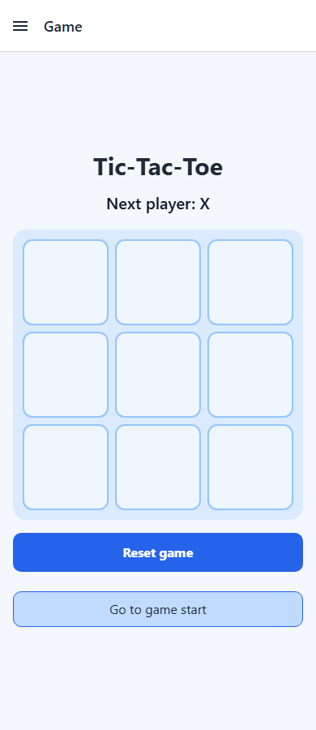
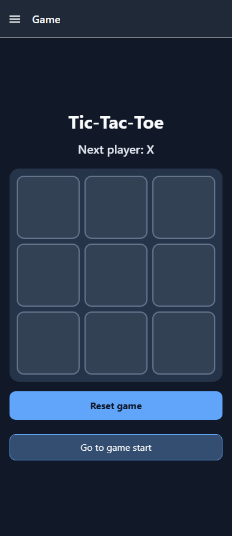

# Small Tic-Tac-Toe Game

A mobile-friendly Tic-Tac-Toe game built with React Native and Expo. Play as X and O, jump back through move history, reset the board, and switch between light and dark themes from Settings.

## Run locally

```bash
npm install
npx expo start
```

Open the app in Expo Go or an emulator to play.

## Features

- 3x3 interactive board
- Turn-based gameplay for X and O
- Winner detection and draw handling
- Move history with time-travel navigation
- Reset button
- Navigation drawer with Game, Settings, and About screens
- App-wide light and dark themes
- Responsive mobile layout

## Screenshots

Add a screenshot of the Game screen in light mode and another in dark mode:




